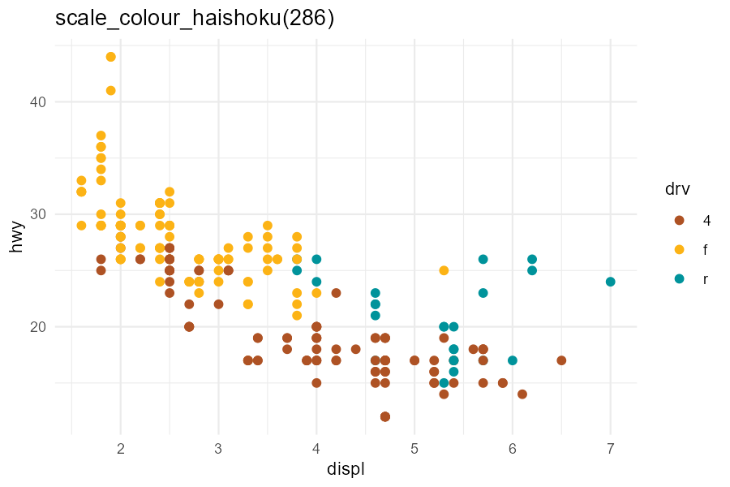
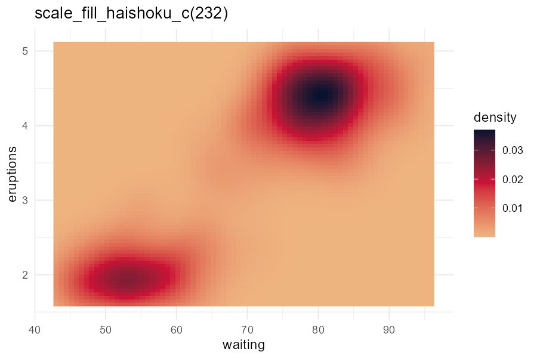
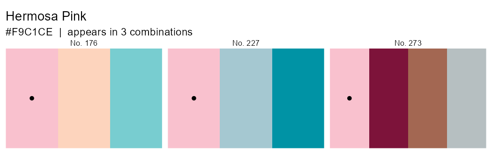
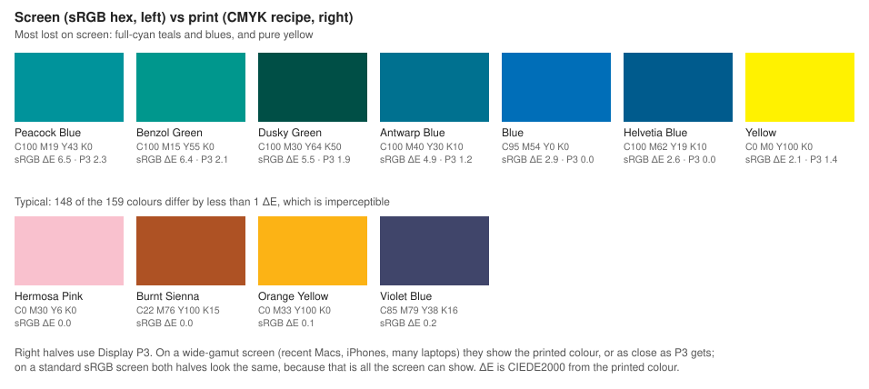
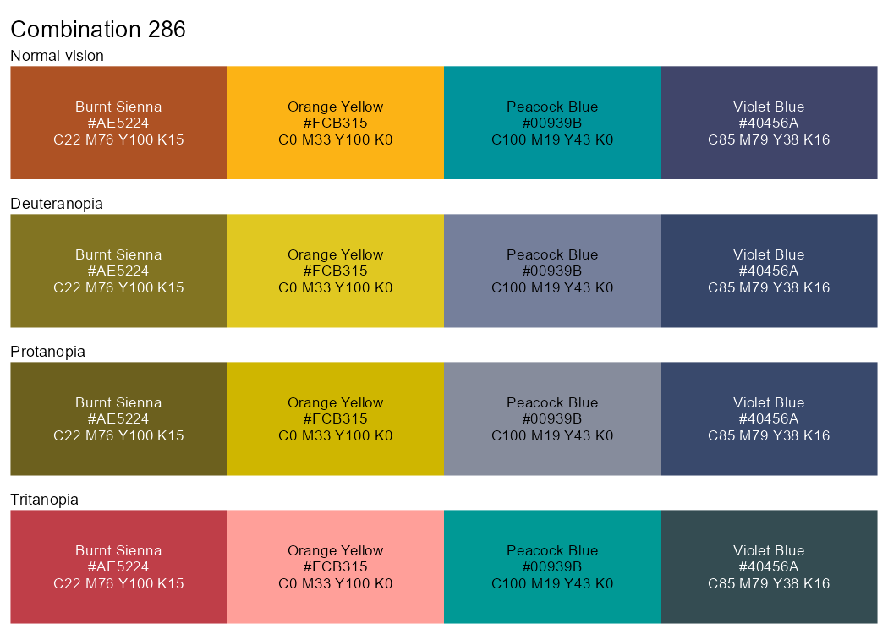
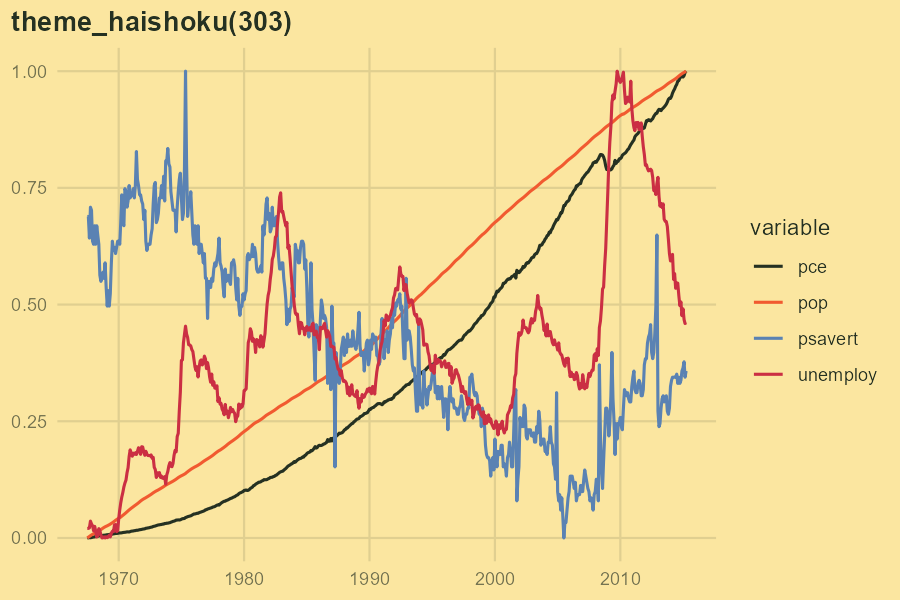
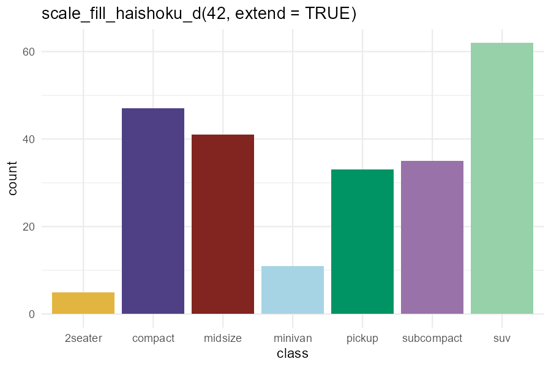

# haishoku <small>配色</small>

Colour palettes from Sanzo Wada's *A Dictionary of Color Combinations*, for R
and 'ggplot2'.

Between 1933 and 1934 the painter and costume designer Sanzo Wada published
*Haishoku Sōkan* (配色総鑑), six volumes of colour combinations. In 2010
Seigensha's editors reworked it into a single compact volume, *A Dictionary of
Color Combinations* (配色事典, *Haishoku Jiten*), with Wada credited as
author. *Haishoku* means colour arrangement. The package includes
all **159 named colours** with the book's **CMYK printing recipes**, and all
**348 combinations** (pairs 1–120, trios 121–240, quads 241–348).

## Installation

```r
# install.packages("remotes")
remotes::install_github("bwwolfe/haishoku")
```

## Palettes and scales

```r
library(haishoku)
library(ggplot2)

haishoku_palette(286)
#> <haishoku_palette: combination 286>
#>  #AE5224  Burnt Sienna
#>  #FCB315  Orange Yellow
#>  #00939B  Peacock Blue
#>  #40456A  Violet Blue

ggplot(mpg, aes(displ, hwy, colour = drv)) +
  geom_point() +
  scale_colour_haishoku(286)
```

Every scale has `colour`, `color` and `fill` versions, in discrete (`_d`),
continuous (`_c`) and binned (`_b`) forms. `scale_*_haishoku()` is discrete
unless `discrete = FALSE`.

```r
ggplot(faithfuld, aes(waiting, eruptions, fill = density)) +
  geom_raster() +
  scale_fill_haishoku_c(232)                 # light-to-dark through the combination

scale_fill_haishoku_c(286, type = "diverging", midpoint = 0)
scale_fill_haishoku_b(232)                   # binned
scale_fill_haishoku_d(42, extend = TRUE)     # more levels than colours
```

 

Palettes also work in base graphics (`barplot(1:4, col = haishoku_palette(286))`),
in `scale_*_manual(values = haishoku_palette(286))`, and as palette functions:
`haishoku_pal(286)`, which plugs into 'ggplot2' 4.0's
`theme(palette.colour.discrete = haishoku_pal(286))`. Set
`options(haishoku.combo = 286)` to change the default combination.

Every `haishoku_` function has a short `hs_` alias for interactive use:
`hs_palette()`, `hs_find()`, `hs_show()` and so on.

## The dictionary

The book's index lists every combination a colour appears in.

```r
haishoku_combos_with("Hermosa Pink")
#>   combo size                                                  colours
#> 1   176    3             Hermosa Pink / Seashell Pink / Calamine Blue
#> 2   227    3       Hermosa Pink / Light Glaucous Blue / Cerulian Blue
#> 3   273    4 Hermosa Pink / Pansy Purple / Sudan Brown / Neutral Gray

haishoku_combos_with(c("Black", "Coral Red"), size = 3)
haishoku_show_colour("Hermosa Pink")
```



Look colours up by name (case, spacing and grey/gray don't matter, and
misspellings get suggestions) or by number. Use `haishoku_search()` to browse:

```r
haishoku_colour(c("hermosa pink", "Cerulian Blue", "58"))
haishoku_search("pink")
haishoku_search(section = 6)       # the neutrals
```

## Colours for print

The CMYK recipes are the book's own values. The hex codes are a screen
conversion from them (SWOP v2 → sRGB), so they won't exactly match the
printed swatches. When the work is going to print, use the recipes:

```r
haishoku_cmyk(haishoku_palette(286))
#>    id          name     hex cyan magenta yellow black           recipe print_delta_e
#> 1  20  Burnt Sienna #AE5224   22      76    100    15 C22 M76 Y100 K15          0.05
#> 2  61 Orange Yellow #FCB315    0      33    100     0   C0 M33 Y100 K0          0.06
#> 3 119  Peacock Blue #00939B  100      19     43     0  C100 M19 Y43 K0          6.55
#> 4 128   Violet Blue #40456A   85      79     38    16  C85 M79 Y38 K16          0.19

cat(haishoku_export(42, "tex"), sep = "\n")    # xcolor definitions in CMYK
#> \definecolor{hsYellowOcher}{cmyk}{0.12,0.28,0.88,0.00}
#> \definecolor{hsViolet}{cmyk}{0.85,0.90,0.18,0.00}
```

`print_delta_e` measures how much is lost on screen: the CIEDE2000 difference
between the recipe as printed (through the SWOP profile) and its hex. For 148
of the 159 colours it is below 1, which is imperceptible. The exceptions are
mostly full-cyan teals and blues, which ink can reach but standard sRGB screens
can't: Peacock Blue (6.6), Benzol Green (6.4), Dusky Green (5.5) and Antwarp
Blue (4.9), plus Blue, Helvetia Blue and pure Yellow at 2–3. On screen these
keep their hue but look duller than in the book.



In each tile, the left half is the hex and the right half is the printed
colour in Display P3. On a wide-gamut screen (recent Macs, iPhones and many
laptops) the right halves of the top row are visibly more vivid. On a standard
screen both halves look identical, because sRGB is all that screen can show.
P3 recovers most of the gap but not all of it: Peacock Blue goes from 6.6 to
2.3, and Blue and Helvetia Blue fit in P3 exactly.

`haishoku_export()` also writes CSS custom properties, GIMP/Inkscape/Krita/Scribus
`.gpl` palettes and JSON.

## Choosing combinations for data

Wada chose his combinations for harmony, not for telling categories apart.
These tools check which ones also work for data.

```r
# Four-colour combinations that stay distinct with deuteranopia and protanopia
haishoku_find(size = 4, min_de = 15, cvd_safe = TRUE)

# Good sequential ramps: large, even lightness steps
haishoku_find(size = 3, sort_by = "l_step")

# Distinctness (CIEDE2000), CVD-simulated distinctness, lightness, contrast
haishoku_metrics(c(42, 286))

# See it as readers with colour vision deficiency would
haishoku_show(286, cvd = "all")
```



The default combination, 286, was picked this way: its smallest colour
difference stays above 20 under simulated deuteranopia and protanopia. It suits
bars, fills and maps best. Its Orange Yellow has only 1.8:1 contrast on white,
below the 3:1 WCAG suggests for graphics, so it can fade as small points or
thin lines on a white background. For those, 269 (Raw Sienna / Pale Burnt
Lake / Aconite Violet / Black) is one of only two quads where every colour
clears 3:1 on white and stays distinct with colour vision deficiency:

```r
scale_colour_haishoku(269)
options(haishoku.combo = 269)   # or make it the default for the session
```

### Extending a combination

The largest combinations have four colours. `haishoku_extend()` adds more from the
dictionary, picking each time the colour most distinct from those already
chosen (with CVD taken into account). It looks first among colours that Wada
paired with the palette's colours elsewhere in the book.

```r
haishoku_extend(42, 7)
haishoku_extend(c("Deep Slate Olive", "Peach Red"), 5, background = "Naples Yellow")
```

### Nearest Wada colour

Convert a brand or existing palette into dictionary colours:

```r
haishoku_nearest(c("#1F77B4", "firebrick"))
#>       input rank  id        name     hex delta_e
#> 1   #1F77B4    1 122        Blue #006EB8    3.55
#> 2 firebrick    1  29 Carmine Red #A62C37    6.34
```

### Roles for information design

`haishoku_roles()` splits a combination into paper, ink and accents. It uses the
lightest colour as the background if it is pale enough, otherwise Wada's
White. It then grades each accent against WCAG contrast: text (4.5:1),
graphics (3:1), or fills only. `theme_haishoku()` uses those roles for the
plot background and text.

```r
haishoku_roles(303)
#>       hex             name       role contrast                       use
#> 1 #FBE6A0    Naples Yellow background     1.00                background
#> 2 #253122 Deep Slate Olive        ink    10.98         text and graphics
#> 3 #F15A30        Peach Red     accent     2.71 fills and decoration only
#> 4 #B6BFC1     Neutral Gray     accent     1.51 fills and decoration only
```

 

## Data and verifying it against the book

`wada_colours` (one row per colour) and `wada_combos` (one row per
colour per combination) are built from two editable CSVs in `data-raw/`:

* `colours.csv`: volume, id, name, section, CMYK, hex, printed Lab (D50),
  Japanese name and a `verified` flag.
* `combinations.csv`: volume, combination, colour and position.

The transcription comes from
[mattdesl/dictionary-of-colour-combinations](https://github.com/mattdesl/dictionary-of-colour-combinations)
(MIT), a corrected fork of Dain M. Blodorn Kim's
[sanzo-wada](https://sanzo-wada.dmbk.io/) data. It has not yet been checked
against a printed copy. To check it, go through the CSVs with the book: fix
names and CMYK values, set `position` to the printed left-to-right order, fill
in `name_ja`, and set `verified = TRUE`. If you correct a CMYK recipe, blank
its `hex` and `print_lab_*` cells and convert it through the same SWOP profile
as the other colours. This runs on Windows and reproduces the transcribed
values: hex to within 4/255 per channel, printed Lab to within 0.5 CIEDE2000.
Then rebuild:

```r
system("powershell -File data-raw/cmyk-convert.ps1 -Csv data-raw/colours.csv")
source("data-raw/02-build-data.R")
```

Corrections so far: *Dull Violet Black* (No. 131) is C100 M90 Y38 K50 (the
transcription had C95 M106), and *Sulphur Yellow* (No. 39) and *Artemisia
Green* (No. 95) were misspelt. *Antwarp Blue*, *Cerulian Blue* and *Rosolanc
Purple* are the book's own spellings.

### Volume 2

*A Dictionary of Color Combinations Vol. 2* (Seigensha, 2020) draws on two
more Wada works: the *Haishoku Sōkan* B edition (1934–35), whose 72 patterns
follow the twelve months, and a 1937 collection of 500 selected designs. It
comes with 172 colour chips. No openly licensed
transcription of it exists yet, so it isn't included. The data model is
ready for it: add rows with `volume = 2` to the CSVs (or fill in
`data-raw/vol2-*-template.csv`), rebuild, and every function takes
`volume = 2`. If a row has CMYK but no hex, the build derives a hex with a
naive formula and says so.

## Licence and acknowledgements

GPL (>= 3). The colour data is © 2020 Matt DesLauriers and distributed under
the MIT licence, building on Dain M. Blodorn Kim's transcription; see
[`inst/COPYRIGHTS`](inst/COPYRIGHTS). Sanzo Wada (1883–1967) made the colours and
combinations, and his work is in the public domain. This package is not
affiliated with Seigensha. See also the
[`sanzo`](https://CRAN.R-project.org/package=sanzo) package by Jacqueline
Maasch, which has 60 hand-picked palettes.
